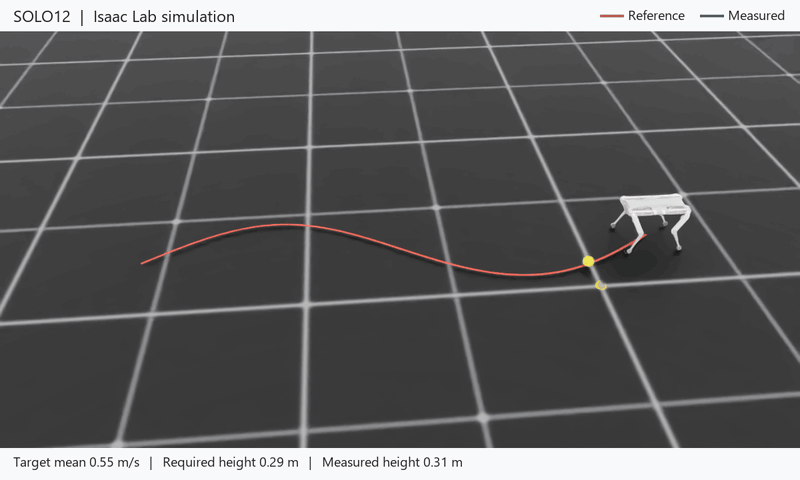
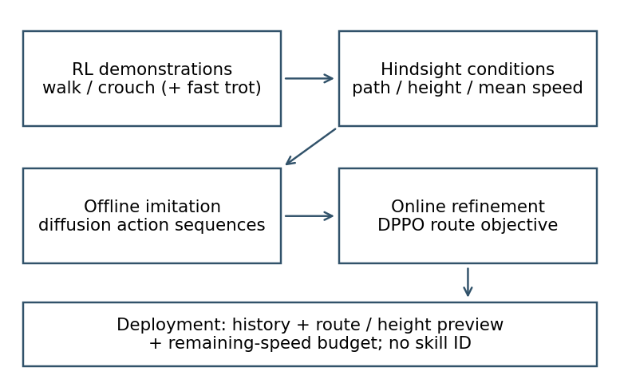
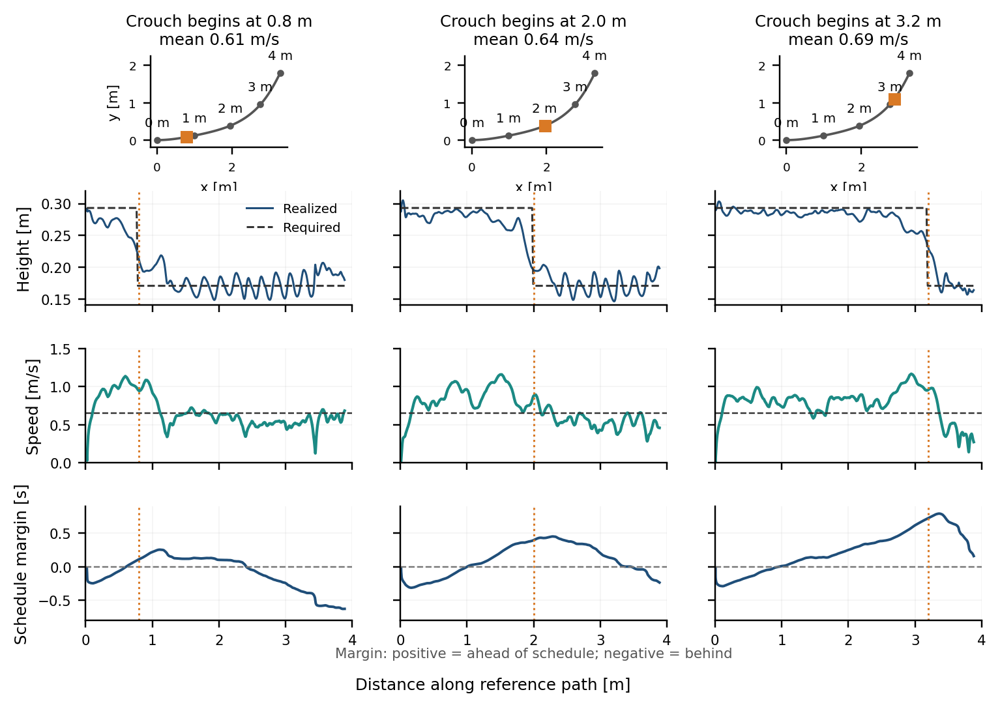
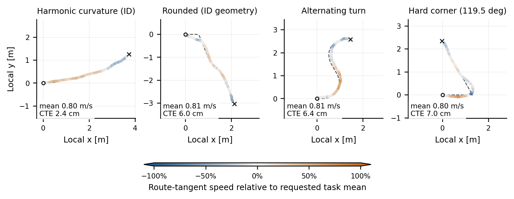
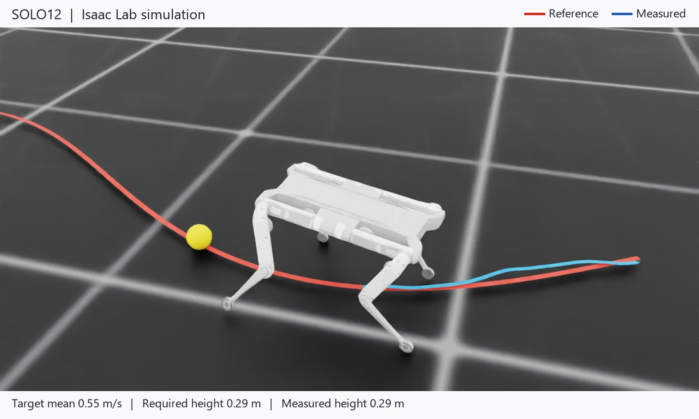
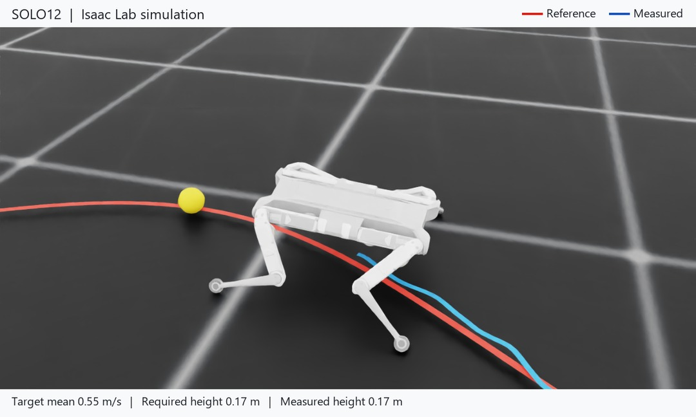
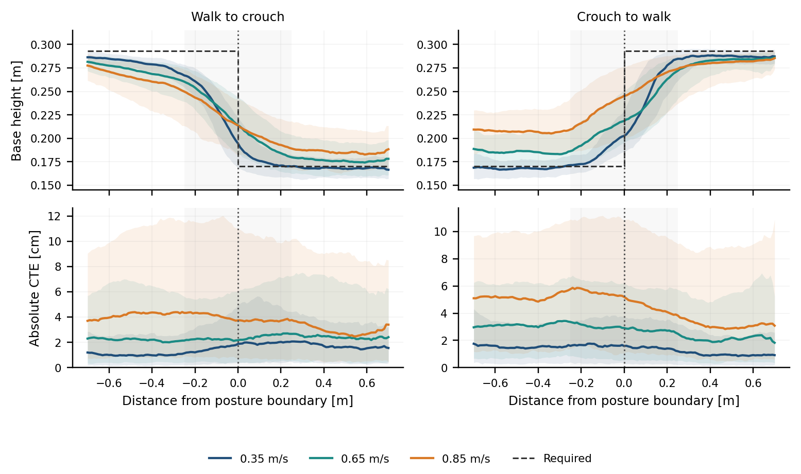

# Diffusion Policies for Path-Conditioned Quadruped Locomotion

Research on learning-based locomotion for the **SOLO12 quadruped** at **IRI (CSIC–UPC)**.

The controller follows a route with a required body-height profile and average speed. We collect trajectories from existing walk and crouch policies, relabel the motion they achieved and use it to train a diffusion policy. Online refinement with Diffusion Policy Policy Optimization (DPPO) improves task completion. The controller does not receive a gait identifier.

[Getting started](docs/project/collaboration.md) · [Method](docs/project/method.md) · [Results](docs/project/results.md) · [Training and evaluation](docs/project/running.md)

*A simulated 4 m route with walk→crouch→walk height requirements and a requested mean of 0.55 m/s. Red shows the reference, orange the preview, blue the measured motion and yellow the preview target. [Demo details](docs/project/media/README.md).*

## From existing behaviours to path-conditioned control

1. **Generate demonstrations** with pretrained locomotion experts under randomized velocity commands.
2. **Relabel achieved motion** as future route geometry, posture and average-speed conditions, without a path-conditioned expert.
3. **Train a diffusion policy offline** to generate joint-action sequences from state, action and condition history.
4. **Refine with DPPO** using route progress, tracking, posture, arrival timing and physical safety.
5. **Execute four actions, then replan.** The final controller acts on the joints directly.

The project evaluates this path, posture and timing interface using existing locomotion data. Hindsight relabelling, diffusion policies and DPPO build on prior work; their roles are described in the [method](docs/project/method.md).

## Average speed allows different local speeds

A target average speed defines how long the route should take. It does not require the robot to maintain one instantaneous speed everywhere.

*Same route, same requested mean of 0.65 m/s, different crouch locations. The controller changes its local pace as the posture requirement moves. The last row shows accumulated timing margin: positive means ahead of a uniform schedule, negative means behind. Achieved means are 0.61, 0.64 and 0.69 m/s, so adaptation is observable but timing is not exact.*

Remaining distance and remaining target time are converted into an explicit speed-budget input. The controller learns how to respond to that feedback; this is not a claim that it discovers a clock or an optimal speed planner.

*Individual rollouts at a requested mean of 0.8 m/s. Blue indicates progress below the mean and orange above it; the annotations describe these rollouts.*

## Posture is specified along the route

| Standing section | Crouching section |
|:--:|:--:|
|  |  |

*The required heights are 0.293 m standing and 0.171 m crouching.*

*Height and path tracking around posture changes. Dashed lines show required height; curves are medians and bands show the 10th–90th percentiles. Grey marks the region excluded from height-profile scoring.*

Reliable interpolation to arbitrary intermediate heights is not established.

## What the experiments show

Offline imitation supplies useful route-following behaviour, but does not reliably satisfy the complete arrival, posture and timing contract. Online refinement substantially improves joint completion.

A matched deterministic transformer followed by Gaussian PPO provides the non-diffusion comparison:

| Condition | Deterministic BC + Gaussian PPO | Diffusion BC + DPPO |
|---|---:|---:|
| Fast crouch → walk | 96.6 ± 1.6% | 99.4 ± 0.4% |
| Fast walk → crouch | 60.9 ± 17.9% | 99.0 ± 0.4% |
| Repeated posture changes, standing start | 6.7 ± 2.1% | 98.5 ± 2.6% |
| Repeated posture changes, crouched start | 11.9 ± 3.6% | 54.6 ± 4.6% |

*Task success, mean ± sample standard deviation across three online seeds per fixed offline prior. Fast rows use ID targets of 0.65, 0.75 and 0.85 m/s. Task success combines arrival, terminal pose, posture and average-speed checks; path-adherence results are reported separately in the [results](docs/project/results.md).*

Both methods solve ordinary routes well. The diffusion-based pipeline performs better on the tested demanding compositions, though repeated crouch-start profiles remain difficult. The comparison does not establish that diffusion is necessary or isolate the cause of the difference.

## Where to find the implementation

This repository is an Isaac Lab fork. Project code lives in a small set of directories:

| Directory | Purpose |
|---|---|
| [`scripts/diffusion_policy/`](scripts/diffusion_policy/) | Demonstration collection, hindsight conditioning, imitation training, playback and evaluation |
| [`scripts/dppo_diffusion_rl/`](scripts/dppo_diffusion_rl/) | Diffusion fine-tuning, route generators, task rewards and frozen evaluation banks |
| [`scripts/gaussian_chunk_rl/`](scripts/gaussian_chunk_rl/) | Matched deterministic BC + Gaussian PPO comparison |
| [`source/.../direct/solo12/`](source/isaaclab_tasks/isaaclab_tasks/direct/solo12/) | SOLO12 locomotion experts and task environments |
| [`docs/project/`](docs/project/) | Method, decisions, experiment interpretation and runnable commands |
| [`research_artifacts/`](research_artifacts/) | Compact result tables and figure checksums |

The [getting-started guide](docs/project/collaboration.md) lists what is needed to run the current controller and begin a comparison. The [artifact guide](docs/project/artifacts.md) records checkpoint and dataset identities and remaining gaps. Weights and datasets are stored separately from the source tree.

## Scope and foundations

The main learning evidence is in Isaac Lab, on open 4 m routes and the evaluated geometry, speed and posture ranges. Physical transfer to an audited MuJoCo model has also been tested on nominal and bounded perturbed development banks. High-speed corners, intermediate heights, and reliable three-gait retention remain open. Real-robot deployment has not been validated.

On a separate post-selection route bank, the selected actor reaches 98.4% adherence on ID tasks at 0.25–0.50 m/s; faster posture conditions remain less reliable. The [validation notes](docs/project/validation.md) describe the bank and runtime tests. Sustained deadlines on the intended robot computer and transport have not been validated.

The approach builds on [DiffuseLoco](https://arxiv.org/abs/2404.19264), [Diffusion Policy](https://arxiv.org/abs/2303.04137), [DPPO](https://arxiv.org/abs/2409.00588) and the broader diffusion-locomotion literature, including [LocoDiff](https://arxiv.org/abs/2411.08832). Their roles in the design are explained in the [method](docs/project/method.md#foundations).

The original framework documentation is preserved in [README_ISAACLAB.md](README_ISAACLAB.md). Isaac Lab and inherited components retain their [licences](LICENSE).
